# SAR processing portfolio: Emmanuel Chidi Ibekwe

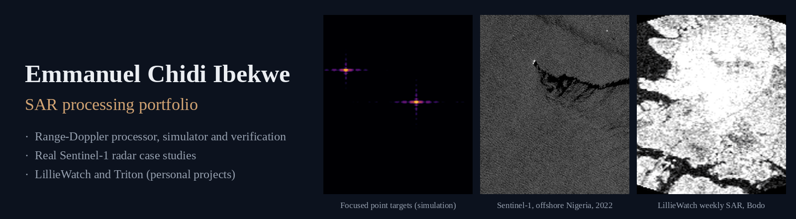

I build software that turns raw synthetic aperture radar (SAR) data into sharp images, checks the
images against requirements, and uses real satellite radar to monitor ships, platforms and possible oil
slicks. This page shows that work in pictures first. The engineering detail and the code follow below.

**Watch the 2-minute overview:** [portfolio_reel.mp4](docs/media/portfolio_reel.mp4)

Emmanuel Chidi Ibekwe · M.Sc. Atmospheric Science, Texas A&M University · College Station, TX ·
[LinkedIn](https://www.linkedin.com/in/ibekwemmanuel7) · ibekwemmanuel@gmail.com

## At a glance

| What a SAR processing engineer does | What I built | Where to see it |
|---|---|---|
| Process raw SAR data into images | A range-Doppler processor and a raw-data simulator | [1. Processing](#1-from-raw-echoes-to-a-sharp-image) |
| Model and verify performance against requirements | Automatic measurement of resolution, sidelobes, position and sensitivity; two defects found and fixed | [2. Verification](#2-proving-it-works) |
| Build simulators for testing | A sea-clutter and oil-slick simulator with known truth | [3. Detector test](#3-testing-a-detector-against-known-truth) |
| Work with real satellite data | Sentinel-1 radar time series over two offshore incidents | [4. Real data](#4-real-sentinel-1-radar) |
| Deliver to users and software teams | LillieWatch site monitoring and Triton offshore watch, with tested code and an API | [5. LillieWatch](#5-lilliewatch-weekly-site-monitoring-personal-project), [6. Triton](#6-triton-offshore-watch-personal-project) |

## 1. From raw echoes to a sharp image

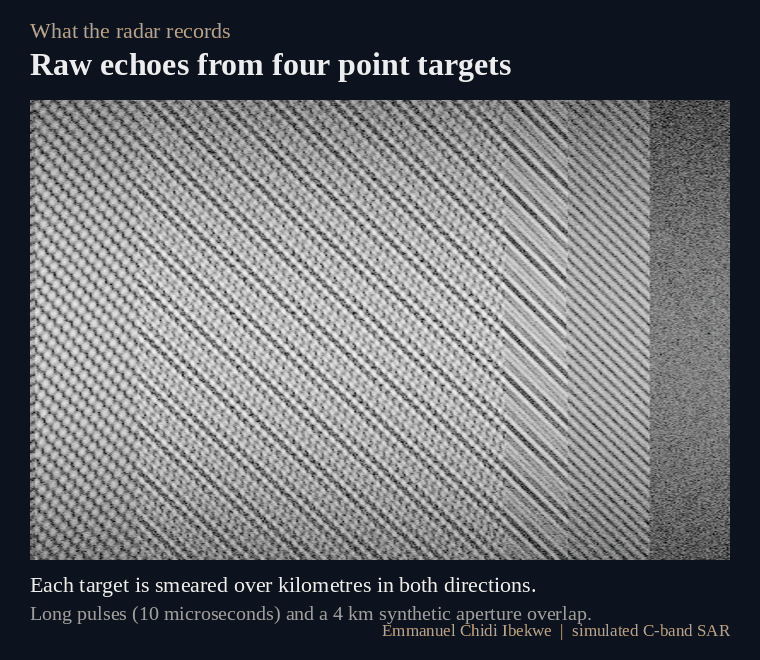

A radar satellite records echoes that are smeared over kilometres. My processor
(`matlab/rda_focus.m`) compresses them in three steps into four sharp points, each about 5 m by 6 m,
within 0.14 m of their true positions. The code is MATLAB-compatible, executed and verified in GNU
Octave, with a separate Python implementation for numerical comparison.

## 2. Proving it works

Every run measures the image quality and compares it with an analytic model and with self-defined
demonstration requirements (not an MDA, ESA or Sentinel-1 specification). All checks pass.

| Check | Requirement | Result |
|---|---|---|
| Sharpness (resolution) | 5.5 m by 6.5 m or better | 5.0 m by 6.3 m |
| Sidelobes (unwanted echoes next to a target) | at least 20 dB below the peak | 20.5 to 27.5 dB below |
| Position error | 1 m or less | 0.14 m or less |
| Sensitivity to weak targets (NESZ) | -22 dB or better | -28.8 to -22.2 dB (model) |

**A defect the verification caught.** The first version failed the sidelobe check on three of four
targets. I traced the cause to the interpolator that corrects range migration, replaced it with a
16-tap Kaiser-windowed design, and added a regression test to detect recurrence of this failure. Details:
[docs/VERIFICATION.md](docs/VERIFICATION.md).

## 3. Testing a detector against known truth

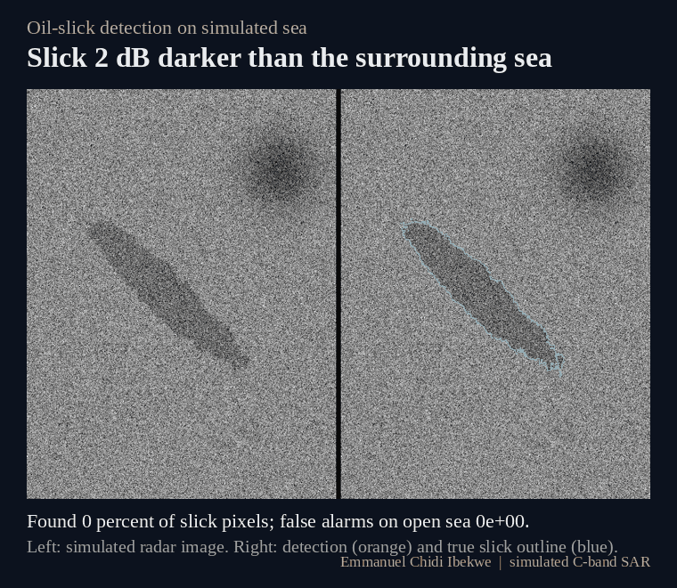

A simulator makes a radar sea surface with a slick of known size and darkness, so the detector can be
scored exactly. It finds 80 percent of the slick at 6 dB contrast and 91 percent at 10 dB, with very
few false alarms on open sea.

## 4. Real Sentinel-1 radar

<table><tr>
<td width="50%">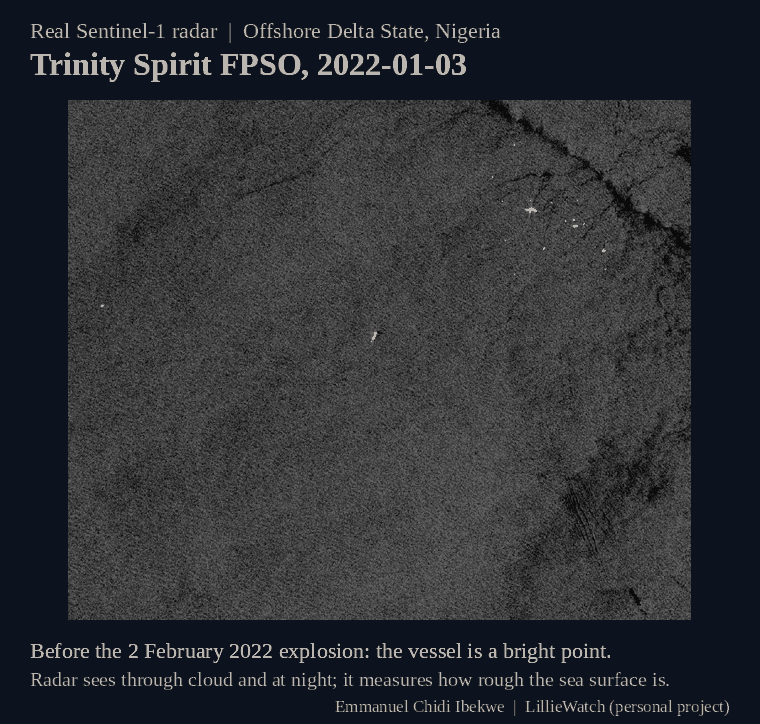 
<b>Trinity Spirit FPSO, offshore Nigeria, 2022.</b> The vessel is a bright point before the
2 February explosion; afterwards, dark features consistent with possible surface slicks appear and then disperse.</td>
<td width="50%">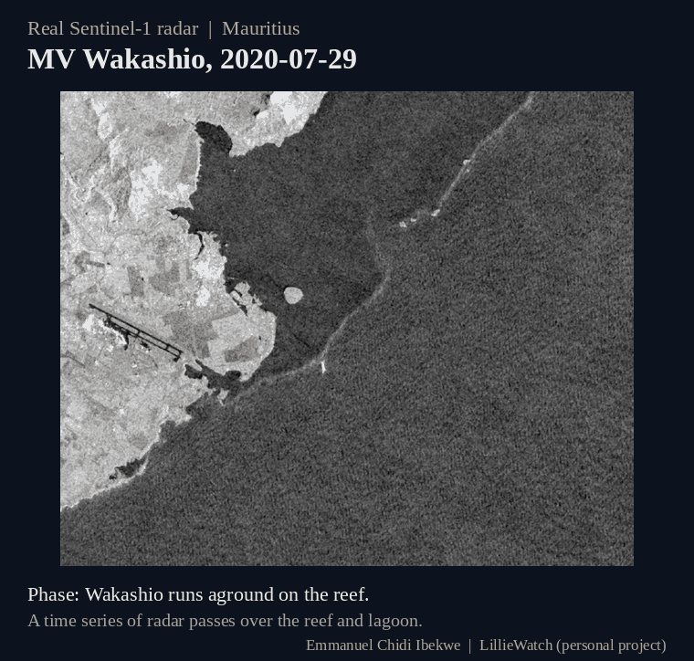 
<b>MV Wakashio, Mauritius, 2020.</b> Radar passes through the grounding, the spill and the
break-up of the ship.</td>
</tr></table>

Radar sees through cloud and at night. Dark sea means smooth water, which can be oil but can also be
calm wind, so every dark feature is a lead for verification, not a confirmed spill. NASA FIRMS thermal
detections corroborate the fire on 2 February 2022; they cannot establish oil composition or source.

## 5. LillieWatch: weekly site monitoring (personal project)

<table><tr>
<td width="45%">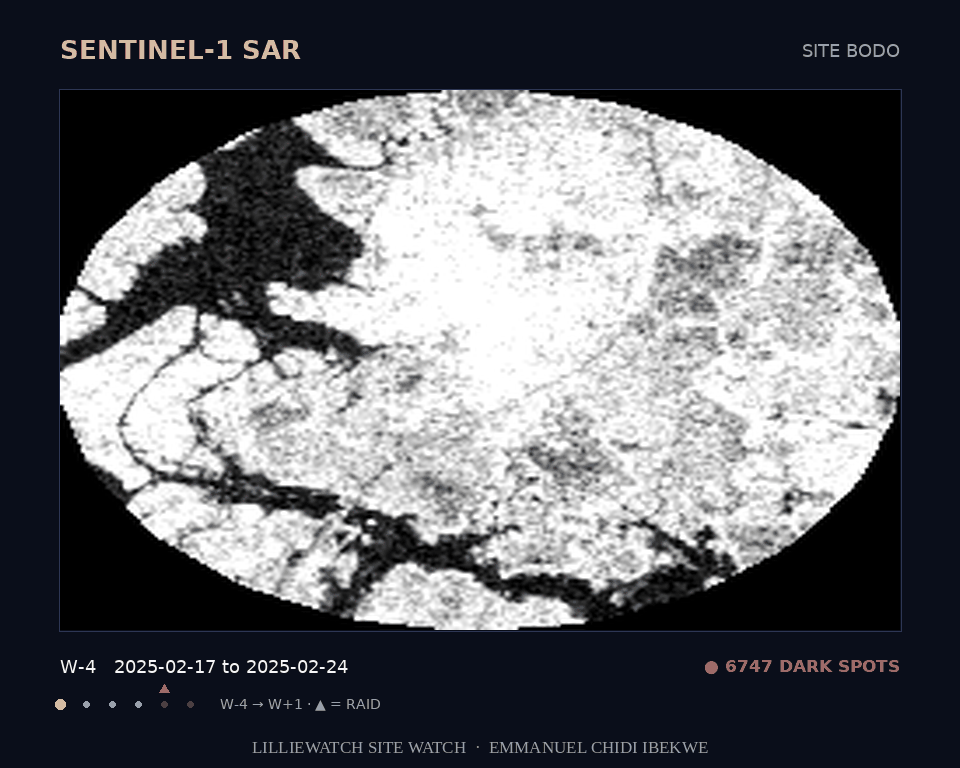</td>
<td width="55%">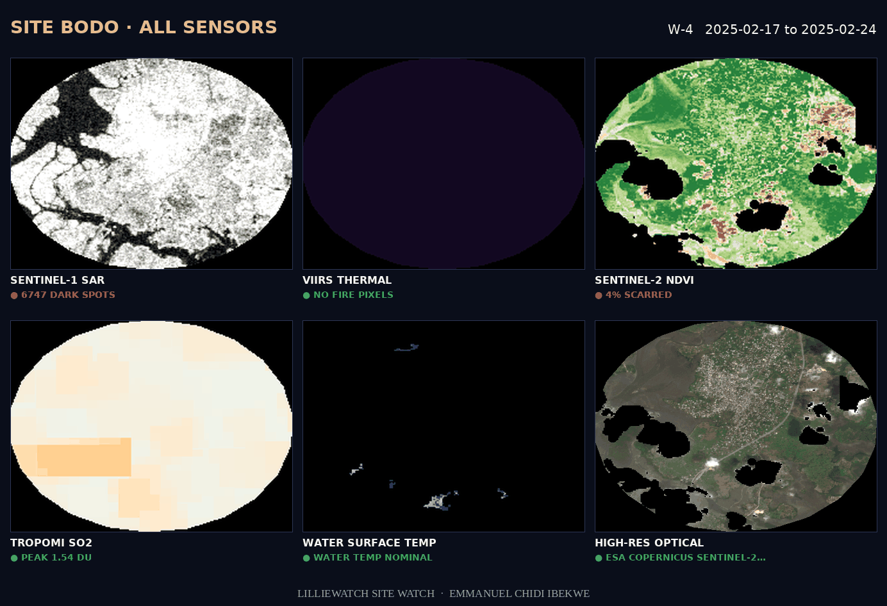</td>
</tr></table>

LillieWatch is my monitoring system for oil and gas sites in the Niger Delta. Every week it processes
Sentinel-1 radar into calibrated products and puts them beside thermal, optical and gas data:

- **Radar preparation:** Sentinel-1 GRD, IW mode, VV and VH in dB at 10 m, fixed orbit geometry,
  weekly median composites to reduce speckle.
- **Change detection in physical units:** each week against a 4-week baseline (a shift of 1.5 dB or
  more and 3 standard deviations), with more confidence when other sensors agree.
- **Creek slick detector:** compares each water pixel with its own 9-month history, then applies
  smoothness, dual-polarisation, wind and persistence tests to reject look-alikes.
- **Vessel detector:** bright targets above the local sea background, with fixed platforms flagged.
- **Delivery:** time-lapse videos, a web API, and an automated test suite (pytest) that gates every change in CI.

The dark-spot counts are image-derived indicators, not spill counts. The code is in a private repository.

## 6. Triton: offshore watch (personal project)

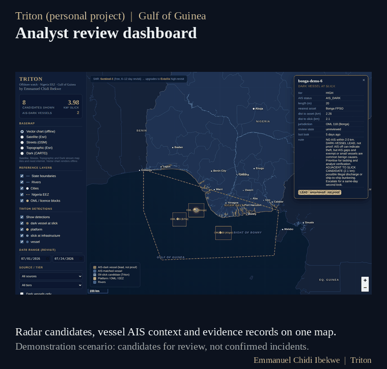

Triton finds possible slicks and vessels in Sentinel-1 scenes over the Gulf of Guinea and puts them on
an analyst review map with ship-tracking (AIS) context. Its ResNet34 U-Net slick model reached pixel F1 agreement of 0.67 (against 0.32 for a classical
method) on eight held-out scenes selected around known Cerulean slicks; this is catalog agreement, not
independent field accuracy.
Everything Triton outputs is a candidate for review. The code is in a private repository.

## 7. Supporting experiment: time-domain backprojection

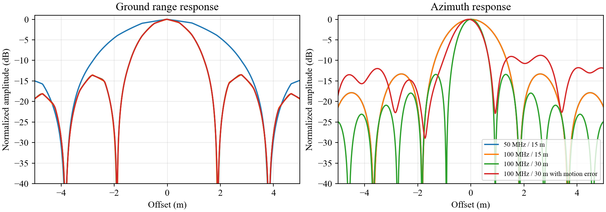

An earlier, separate Python lab forms images by backprojection to show how bandwidth, aperture length
and platform motion error change the image: doubling the bandwidth halves the range width (3.25 to
1.63 m), and motion error reduces the focused peak amplitude from 0.99 to 0.27.
[Walkthrough video](docs/media/backprojection_walkthrough.mp4).

---

## Technical detail (for engineers)

| Job requirement | Where it is in this repository |
|---|---|
| Develop algorithms to process SAR data | `matlab/rda_focus.m`: range-Doppler algorithm (replica range compression, azimuth FFT, RCMC with a Kaiser-windowed sinc interpolator, exact zero-squint azimuth compression, spectral weighting). `detect_dark.m`: adaptive-threshold oil-slick detector. |
| Model and verify system performance to meet specifications | `irf_model.m` (analytic IRF from the processed spectra), `measure_irf.m` (IRW, PSLR, ISLR, location error), `nesz_model.m` (radar-equation NESZ), `run_all.m` (requirement checks). See `docs/VERIFICATION.md`. |
| Develop and maintain simulators for testing and verification | `simulate_raw.m` (point-target raw-data simulator: LFM chirp, hyperbolic range history, two-way antenna pattern, noise). `slick_scene.m` (K-distributed sea clutter with an oil slick and a low-wind look-alike, with truth masks). Regression tests in `matlab/tests` and `python/tests`. |
| Collaborate with ground and software teams | Same algorithms in two languages with agreeing numerical results, scripted runs, CSV outputs, tests that run headless (CI-ready). |

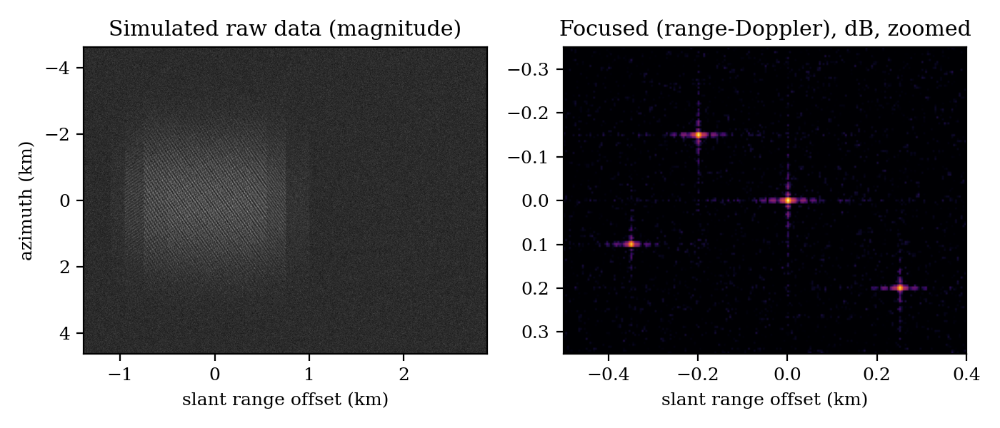

## Results (C-band stripmap, Sentinel-1-like parameters)

Weighted reference case: Hamming weighting (alpha = 0.75), replica range filter. Four point targets.
The thresholds are **self-defined demonstration requirements**. They are not an MDA, ESA or Sentinel-1
acceptance specification.

| Metric | Demonstration requirement | Analytic model | Measured (4 targets, GNU Octave) | Result |
|---|---|---|---|---|
| Slant-range IRW | <= 5.5 m | 4.99 m | 5.03 to 5.04 m | PASS |
| Azimuth IRW | <= 6.5 m | 6.21 m | 6.24 to 6.27 m | PASS |
| Measured IRW vs model | within 3 % | | +0.8 to 1.0 % (range), +0.5 to 1.0 % (azimuth) | PASS |
| PSLR (range / azimuth) | <= -20 dB | -21.4 / -26.9 dB | -20.5 to -20.9 / -26.3 to -27.5 dB | PASS |
| ISLR (range / azimuth) | <= -15 dB | -16.0 / -22.0 dB | -16.3 to -16.4 / -22.5 to -22.9 dB | PASS |
| Peak location error | <= 1 m | 0 | <= 0.14 m | PASS |
| NESZ, 20 to 46 deg incidence | <= -22 dB | -28.8 to -22.2 dB | (model) | PASS, 0.2 dB margin at far range |

The unweighted case reproduces the sinc response (range PSLR -13.1 dB against -13.3 dB theory).
The separate Python implementation gives the same IRW to within 0.01 m, and PSLR to within about 1 dB (different noise realisation).

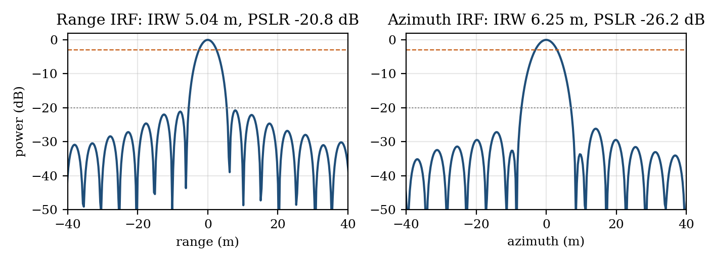

### A defect found by the verification
The first processor used an 8-tap plain sinc interpolator for range cell migration correction. The
verification run showed range PSLR of -19.7 to -20.2 dB, so three of four targets failed the -20 dB
requirement, while the analytic model predicted -21.4 dB. Disabling RCMC on an isolated target
restored -21.7 dB, which isolated the interpolator. A 16-tap Kaiser-windowed sinc kernel brings the
range PSLR to -20.5 to -20.9 dB. A regression test now holds the range PSLR within 1 dB of the model.
A second defect: applying the full azimuth filter phase exp(j4πfcR/c) per range cell put a
range-varying phase ramp on each target and distorted the upsampled response (range IRW measured
8 % below theory). The filter now applies only the Doppler-dependent term.

## Oil-slick detection against simulated truth

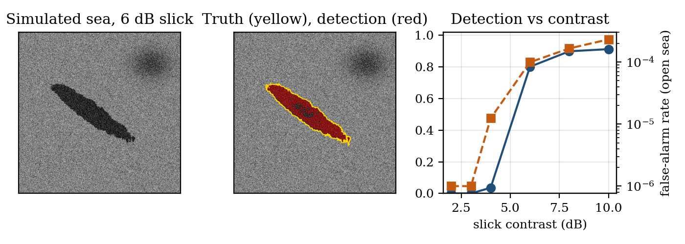

Probability of detection rises from 0 at 2 to 3 dB contrast to 0.80 at 6 dB and 0.91 at 10 dB, with
open-sea false-alarm rates of 1e-5 to 2e-4. The broad low-wind look-alike is not flagged, because the
adaptive background window follows it; a look-alike smaller than the window would be. This is why
dark-spot detection is a first stage, followed by shape and context checks against a pre-event image.

## Applied work on real Sentinel-1 data

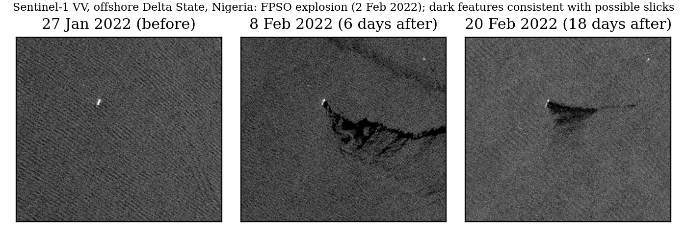

## How to run

MATLAB-compatible (verified in GNU Octave), from `matlab/`:

    run_all              % simulate, focus, measure, verify; writes results/
    run_slick            % slick detector sweep over contrast and looks
    run('tests/test_rda.m')

Python 3.10+, from `python/`:

    pip install numpy scipy matplotlib pytest
    python run_all.py    # figures in docs/figures
    python make_media.py # animations in docs/media (simulation)
    python -m pytest -q  # 5 tests

Runtime: under a minute (Octave) or 10 s (Python) on a laptop. Raw data 2048 x 1024 complex samples.

## Simplifications (stated so the results are read correctly)
Straight-line geometry with an effective velocity, zero squint, no Earth curvature or Doppler
centroid estimation, no secondary range compression (not needed at this squint and bandwidth),
point targets only for the IRF tests, and an image-domain (not raw-domain) clutter simulator for the
slick tests. Natural extensions: squinted geometry and secondary range compression, chirp scaling or
omega-k, Doppler centroid and autofocus, and ambiguity (AASR, RASR) analysis.

## References
Cumming, I. G. and Wong, F. H. (2005). *Digital Processing of Synthetic Aperture Radar Data.* Artech House.
Curlander, J. C. and McDonough, R. N. (1991). *Synthetic Aperture Radar: Systems and Signal Processing.* Wiley.

MIT licence for the code in this repository. LillieWatch and Triton are my personal projects; their code is private and only their outputs are shown here. Animations are made by `python/make_media.py`, `python/make_case_media.py` and `python/make_reel.py`. Real-data images contain modified Copernicus Sentinel data (2020 to 2025).
